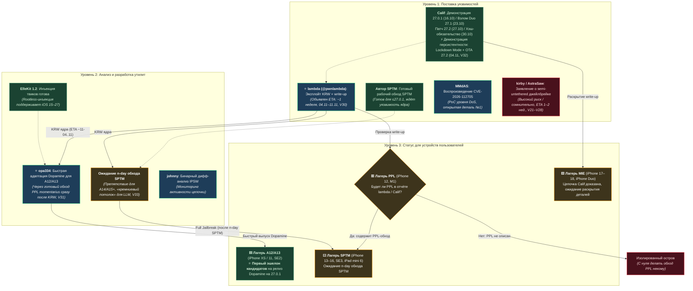

# Инцидент с джейлбрейком iOS 27.0.1 · Фактчекинг и мониторинг событий

[Русский](README.md) | [中文版](README_ZH.md) | [English Abstract](#english-abstract)

> **Данные по состоянию на 03.11.2026 · События развиваются, архив регулярно обновляется**
> Данный репозиторий представляет собой **архив фактчекинга** демонстрации непривязанного (untethered, сохраняющегося после перезагрузки) джейлбрейка iOS 27.0.1 на iPhone 18 Pro, представленной исследователем Calif 16 октября 2026 года на конференции Hexacon в Париже: параллельная проверка по 10 направлениям, перекрёстная верификация, 127 источников литературы. Репозиторий не содержит утилит для джейлбрейка или эксплойтов.
>
> 📌 **Последние новости (04.11)**: Участница команды Calif lambda (@pwnlambda / Анна Гроза) анонсировала готовность эксплойта ядра (KRW) и write-up в течение примерно недели (V30). Разработчик Dopamine opa334 взял обязательство оперативно адаптировать джейлбрейк для процессоров A12/A13 на базе готового обхода PPL momentarius (V31), в то время как процессорам A14+ всё ещё необходим n-day обход SPTM («кремниевый потолок» для LLM, V33). Calif также продемонстрировали кросс-версионную персистентность (Lockdown Mode ON, обновление OTA до 27.2, перезагрузка — твики сохраняют работоспособность, V32). **iOS 27.0.1 всё ещё подписывается (актуально на 02.11) — не обновляйтесь на 27.2**; инъекция твиков ElleKit 1.2 готова (rootless-инъекция поддерживает iOS 15–27). Подробнее см. в [CHANGELOG](CHANGELOG.md).

## Инженерная схема прогресса экосистемы (снимок на 04.11.2026)

**Как читать схему**:
- 🎯 **Первый конкретный дедлайн**: lambda (Анна Гроза) дала чёткий публичный ETA (~1 неделя до выхода KRW и write-up, V30), заменив неопределённое «ожидание раскрытия Calif».
- 🚀 **A12/A13 в первом эшелоне**: благодаря готовому обходу PPL momentarius чипы A12/A13 первыми получат поддержку Dopamine от opa334 сразу после выхода KRW (V31).
- 🧱 **Препятствие для A14/A15+**: для лагерей SPTM/PPL одного KRW ядра недостаточно — требуется n-day обход SPTM («кремниевый потолок» для современных нейросетей, V33).
- 🔒 **Персистентность Calif**: демонстрация выживания твиков после OTA-обновления до 27.2 наглядно подтверждает высокий уровень контроля над системой (V32), однако для обычных пользователей уязвимости в 27.2 уже закрыты — окно остаётся строго на 27.0.1.
- ⚠️ **AstraSaw**: проект от 01.11 классифицирован как сомнительный с высоким риском и оставлен на схеме лишь для фиксации процесса проверки.

[English abstract below](#english-abstract)

---

## Три ключевых вывода

1. **Событие реально**: факт проведения конференции, статус компании и ход демонстрации подтверждены независимыми первоисточниками и шестью авторитетными СМИ. Главным техническим подтверждением служит полное совпадение номера сборки ядра XNU на экране с реальными panic-логами пользователей iOS 27.0.1. Однако: *«успешная демонстрация ≠ публикация уязвимостей ≠ скорый релиз утилиты»*.
2. **Вывод вирусного отчёта о рекомендации к обновлению верен по направлению, но содержит три грубые фактологические ошибки**: «первый untethered-джейлбрейк со времён iOS 9» (на самом деле в 2021 году вышел Fugu14), «в iOS 27 прекращена поддержка iPhone 11» (опровергнуто официальными спецификациями Apple), «исправление выйдет в следующем 27.0.x или 27.1» (для обычных iPhone ветки 27.1 не существовало, фактическим каналом закрытия стал релиз 27.2).
3. **Для пользователей устройств с процессорами A14/A15 (iPhone 12 Pro Max, iPad mini 6 и др.) выгода от решения «оставаться на iOS 26 в ожидании взлома» равна абсолютному нулю**: джейлбрейк Dopamine 3.0 для iOS 26.0–26.0.1 поддерживает только процессоры A12/A13; для A14/A15 публичный потолок джейлбрейка по-прежнему зафиксирован на iOS 17.3.1.

## ⚠️ Распознавание скама: AstraSaw как наглядный пример

В периоды ажиотажа вокруг джейлбрейка неизбежно активизируются фейковые проекты. Ситуация с AstraSaw (появился 01.11) демонстрирует 4 хрестоматийных признака, полезных для выявления будущих подделок:

| Признак | Проявление в инциденте AstraSaw |
|---|---|
| Свежий аккаунт + увод аудитории в приватные каналы | Аккаунт в X создан в апреле 2026, в био лишь слово «meow», ссылка на личный профиль в Telegram |
| Отказ от публикации PoC, показ лишь непроверяемых картинок | В твите «proof» содержится одно слово и скриншот логов; исходный код и независимое воспроизведение отсутствуют |
| Обещания скорого релиза готовой утилиты (нагнетание ETA) | Заявлен выпуск готового джейлбрейка через 1–2 недели (прямая противоположность легитимному пути «раскрытие отчёта + возможный PoC») |
| Колоссальный разрыв между заявлениями и подтверждённым опытом | Заявлен первый в мире обход SPTM; в реальности опыт ограничивается школьным сайтом и серверной частью Minecraft |

**Правила безопасности**:
1. Любые файлы («установочные пакеты / IPA / профили конфигурации») от подобных источников по умолчанию расцениваются как потенциально вредоносные программы — категорически не устанавливайте их.
2. Оценка надёжности опирается на 4 фильтра: опыт, прецеденты, подтверждение экспертами, поведенческий профиль (см. [CONTEXT.md](CONTEXT.md) «Оценка цепочки по самозаявлениям»), а не на число подписчиков или оформление картинок.
3. Полная доказательная база собрана в [исследовательском досье AstraSaw](research/astrasaw-audit.md).
4. Важно отличать **ошибки интерпретации СМИ** от умышленных фальсификаций: скриншоты root на 27.0.1 от исследователя Din3zh являются реальной работой на базе bootrom A13/usbliter8 (не новая уязвимость, не применима к A14+), ошибочно названной новостными каналами «новой уязвимостью» (V29); к нему методология скама не относится.

## Аргументы в пользу применимости цепочки 27.0.1 к старым версиям и чипам (в порядке убывания силы)

1. **Уязвимости находятся в общем разделяемом коде**: цепочка включает побег из песочницы → чтение/запись ядра → обход защитного слоя SPTM, а также затрагивает CoreTrust/Cryptex. Это единая для всех устройств и версий iOS кодовая база, не ограниченная конкретной ревизией кремния.
2. **Пробитие защит обладает обратной совместимостью сверху вниз**: цепочка успешно сработала против наиболее защищённых систем с MIE + SPTM на процессорах A19 (включая 17e) и A20 Pro. Чипы A15 защищены лишь SPTM (обход которого уже входит в цепочку), а чипы A14 защищены ещё более старым механизмом PPL (для которого существует множество публичных наработок). Портирование на старые чипы логически обосновано.  
   ⚠️ *Уточнение от 18.10: исследователь johnny предположил, что в демонстрации Calif мог не использоваться обход SPTM; однако параллельно существует **независимый рабочий обход SPTM** (валидный для ≤27.0.1, закрытый в 27.2b3, подтверждён автором Dopamine opa334) — таким образом, для чипов A15 сохраняется конкретный независимый путь.*  
   ✅ *Обновление от 21.10: интервью Штефана Эссера подтвердило, что цепочка **обходит защиту MIE** и «в целом применима к любому iPhone под управлением 27.0.1 (предположительно включая iPad)» — совместимость со старыми чипами перешла из разряда теоретических выводов в официальное заявление автора.*  
   ✅ *Обновление от 24.10: iPhone Duo (A20 Pro / MIE / 27.1) был взломан непосредственно в день старта продаж; бинарный анализ подтвердил присутствие уязвимостей цепочки как в 27.0.1, так и в 27.1.*
3. **iPhone 12 официально остаётся в списке поддерживаемых устройств iOS 27**: чип A14 по-прежнему является первоклассной целью поддержки, ядро, стек драйверов и CoreTrust в iOS 27 содержат таргеты сборки под A14, аппаратного поколенческого барьера нет.
4. **Оптимизация производительности подтверждает непрерывность архитектурного пути**: доработки планировщика процессора в iOS 27 затронули даже линейку iPhone 11 (чипы A13, старше A14), что подтверждает единство низкоуровневой кодовой базы и отсутствие непреодолимых преград для переноса эксплойтов.
5. **Требования к AI не изолируют уязвимости**: функционал Apple Intelligence является лишь программным фильтром (для моделей 15 Pro и новее), а не отдельной сборкой операционной системы; устройства без AI работают на абсолютно том же ядре и дисковой подсистеме, цепочка не зависит от функций ИИ.
6. **Подтверждение из первоисточников**: издание heise прямо указало формулировку «применимо к версиям вплоть до iOS 27.0.1»; инсайдеры подтвердили тестирование на процессорах 18 Pro и 17e («для версий ≤27.0.1 всё выглядит многообещающе»).

**Три критических ограничения, о которых необходимо помнить**:
1. *Версионный охват*: работа эксплойта на версиях ≤26.x никогда не демонстрировалась, неизвестно, не появились ли эти уязвимости только в ветке iOS 27.
2. *Универсальность цепочки ≠ готовность утилиты*: адаптация под чипы A14/A15 потребует существенных инженерных усилий сообщества после публикации отчёта.
3. *Формат релиза зафиксирован*: **утилит для конечных пользователей не будет; запланировано раскрытие отчёта (write-up) и, возможно, демонстрационный PoC** (интервью Эссера от 19.10); 04.11 lambda дала первый конкретный ETA (около 1 недели до публикации эксплойта KRW и write-up, V30). Напоминание: публичный эксплойт Titan для чипов A14 ограничен версиями ≤17.4b3 и не решает проблему для 27.0.1; проект AstraSaw от 01.11, заявлявший о поддержке «всех iPhone», классифицирован как высокорисковый фейк и не меняет эти ограничения.

## Схема лагерей процессоров: к какой группе относится ваше устройство?

Для устройств, чей публичный джейлбрейк остановился на iOS 17.3.1, ветка 26.x недоступна, а надежда возлагается на окно ≤27.0.1, карта делится на 4 лагеря:

| Лагерь | Процессоры | Модели устройств | Чего не хватает до джейлбрейка |
|---|---|---|---|
| 🟥 **Лагерь PPL** *(появился шанс)* | A14, M1 | Вся линейка iPhone 12, iPad Air 5, iPad Pro 2021 | **Две детали пазла**: обход PPL + новая уязвимость ядра. ✅21.10: Эссер заявил, что цепочка обходит MIE и «применима к любому устройству на 27.0.1» — обход PPL **потенциально может входить в цепочку**, ждём write-up. Если отчёт не будет содержать наработок по PPL, вердикт вернётся к исходному (эксплойт Titan работает только на ≤17.4b3 и для 27.0.1 бесполезен). |
| 🟨 **Лагерь SPTM** *(минимальный разрыв)* ⭐ | A15, A16, A17 Pro, A18/Pro, M2/M3/M4 | Вся линейка iPhone 13→16, SE3, iPad mini 6/7, iPad Air (M2/M3), iPad Pro (M4) | **Не хватает ровно одной детали**: новой уязвимости ядра для версий выше 26.0.1 (готовый рабочий обход SPTM уже существует и валиден для ≤27.0.1); после релиза KRW от lambda станет понятно, удастся ли подключить независимый обход SPTM. |
| 🟩 **Лагерь MIE** *(дважды продемонстрирован)* | A19 (включая 17e), A20 Pro | Вся линейка iPhone 17, iPhone 18 Pro, **iPhone Duo** | Calif лично продемонстрировал цепочку вживую (18 Pro на 27.0.1 + **Duo на 27.1 в день старта продаж**). Остаётся дождаться раскрытия write-up и создания утилит сторонними разработчиками. |
| 🟦 **A12 / A13** *(первые кандидаты ⭐04.11)* | A12, A13 | iPhone XS/XR/11, SE2, iPad 8, iPad Air 3, iPad mini 5 | Уже на берегу (на 26.0.1 двойная страховка); **с 04.11 стали первыми кандидатами на получение Dopamine на 27.0.1**: обход PPL momentarius уже готов, ожидается лишь выход KRW от lambda; opa334 обязался оперативно адаптировать джейлбрейк (V31). |

**Главный вывод**: лагерь SPTM охватывает четыре поколения устройств (iPhone 13→16), это самая массовая аудитория с минимальным дефицитом компонентов; однако **после 04.11 порядок реализации прояснился: первыми пойдут A12/A13 (все уровни защиты уже готовы), а лагеря SPTM/PPL ждут n-day обхода SPTM** — при этом opa334 считает создание такого обхода недосягаемым для современных LLM («кремниевый потолок», отсутствие готовых образцов в обучающей выборке, в отличие от Coruna). Ключевая точка наблюдения для лагеря PPL (A14/M1) остаётся прежней: **будет ли write-up lambda содержать детали по PPL/A14**.  
⚠️ **27 октября состоялся релиз iOS 27.2**, устранивший подавляющую часть уязвимостей цепочки — окно цифровой подписи iOS 27.0.1 вышло на финишную прямую (на 02.11 подпись всё ещё открыта).

## Сводка вердиктов фактчекинга

| Категория | Кол-во | Примеры положений |
|---|---|---|
| Ключевое событие подтверждено (источники уровня T1) | — | Ход демонстрации, профиль компании, технические детали подтверждены независимыми источниками |
| Фактические ошибки E1–E3 | 3 | Опровержение прецедента Fugu14 / iPhone 11 не был исключён / Ошибка в номере версии с патчем (частично опровергнуто) |
| Требуют корректировки P1–P6 | 6 | Завышенные показатели производительности, требования к Siri AI, статус утилиты usbliter8 и др. |
| Критические умолчания O1–O3 | 3 | Для A14/A15 нет джейлбрейка на 26.x, ветка 26 продолжает поддерживаться, необратимость обновления прошивки |
| Дополнения мониторинга V7–V33 | 27 | Обход SPTM / Уязвимость ядра / Интервью Эссера / Взлом iPhone Duo / Охват версии 27.1 / Кодовое имя Chollima / Релиз 27.2 и 6 CVE / Независимое воспроизведение / Слухи о root на 27.2 / Хэш-обязательство / **AstraSaw (высокий риск / сомнительно) / Уточнение CASLR / Подпись 27.0.1 активна / Готовность ElleKit / Экспертиза Din3zh = линия A13 bootrom (ошибка СМИ) / lambda: старт обратного отсчёта до KRW (1 неделя) / opa334: обязательство адаптации A12·A13 и терминологическая иерархия джейлбрейков / Демонстрация Calif кросс-версионной персистентности (Lockdown Mode + OTA 27.2)** |

## Структура репозитория

| Путь | Содержимое |
|---|---|
| `report/full-audit.md` | Полный аудиторский отчёт (~9 600 знаков, 281 цитата, 127 библиографических источников) |
| `research/` | 10 архивов по направлениям проверки + перекрёстная верификация + инсайты + 4 направления проверки инцидента с iPhone Duo + **исследовательское досье расследования AstraSaw** |
| `data/claims.json` | Машиночитаемая база утверждений: claim / verdict / confidence / sources |
| `data/timeline.json` | Хронологическая шкала событий (регулярно пополняется) |
| `CONTEXT.md` | Терминологический глоссарий предметной области (авторитетные определения: «цепь», «деталь», «лагерь», «окно», «третья цепь», «оценка цепочки по самозаявлениям», momentarius, иерархия типов джейлбрейка и др.) |
| `SKILL.md` | Манифест навыка для ИИ-агентов (AI Agent Skill) |
| `CHANGELOG.md` | Журнал хронологических обновлений ситуации |

## Входная точка для ИИ-агентов (Agent Skill)

Данный репозиторий спроектирован как **Agent Skill**: при клонировании репозитория в каталог skills ИИ-агента (или установке в виде `.skill`-пакета) агент при вопросах вида *«джейлбрейк iOS 27 / Calif / демонстрация на Hexacon / iPhone Duo / AstraSaw / стоит ли обновляться с 26 на 27 / поддерживает ли мой процессор джейлбрейк»* автоматически использует выводы и ссылки из данного архива. Подробнее см. в `SKILL.md`.

## Отказ от ответственности

Данный репозиторий является архивом журналистского фактчекинга и исследований в области информационной безопасности, предназначенным исключительно для ознакомления. Он не предоставляет и не оценивает способы получения инструментов для джейлбрейка, а также не содержит рекомендаций или гарантий по обновлению/необновлению операционной системы. Все выводы снабжены оценкой степени достоверности и указанием временных рамок их актуальности.

---

## English abstract

Fact-check archive of the **iOS 27.0.1 untethered jailbreak demo** by Calif at Hexacon 2026 (Paris, Oct 16) — and the follow-up **iPhone Duo release-day compromise** (Oct 23). The events are verified (primary sources + kernel build match with real panic logs), but the viral report around them contains 3 factual errors, 6 overstatements, and 3 critical omissions — most importantly: the Dopamine 3.0 jailbreak for iOS 26.0–26.0.1 only covers A12/A13 chips, so A14/A15 devices gain nothing by staying on iOS 26. **Latest (Nov 4): Calif member lambda (@pwnlambda / Anna Groza, identity confirmed via Apple's CVE-2026-112611 credit) announced an iOS kernel read/write exploit + writeup within roughly a week; opa334 pledged quick Dopamine support for A12/A13 via momentarius, while A14+ still needs the n-day SPTM bypass ("above the silicon ceiling" for LLMs). Calif also demoed cross-version persistence: Lockdown Mode on, OTA update to 27.2, reboot — tweaks still alive (mechanism undisclosed). Verdicts for A14/A15 devices unchanged: stay on 27.0.1 (still signed as of Nov 2), avoid 27.2. Previously: AstraSaw rated HIGH-RISK DOUBTFUL (see `research/astrasaw-audit.md`); Din3zh's root shots = known A13 bootrom line (media misreading); 27.2 shipped with 163 CVEs (6 Calif credits); CVE-2026-112705 independently reproduced (DoS-grade).** Includes a chip-camp map (PPL vs SPTM vs MIE), an ecosystem progress diagram, and a scam-pattern field guide. Full audit in `report/` (Chinese & Russian), machine-readable claims in `data/claims.json`, living timeline in `data/timeline.json`. Data as of 2026-11-04; evolving story.

License: CC BY 4.0 — attribution required when reusing content.
